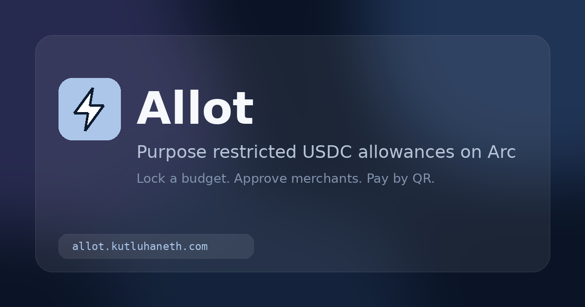

# Allot

**Purpose restricted USDC allowances on Arc. Lock funds for a stated purpose, approve the merchants that can receive them, and let the recipient pay by QR.**

🌐 **Live app:** https://allot.kutluhaneth.com



## What it does

Allot lets a funder lock USDC for a recipient who can only spend it at approved merchants for a stated purpose. Payments happen with a merchant QR code and an EIP-712 `Spend` authorization signed by the recipient. Unspent funds can be reclaimed after expiry, or returned earlier when the funder closes the allowance.

1. **Create an allowance.** The funder sets a total budget, a per purchase limit, an expiry, a purpose label, and the merchant addresses that may receive funds.
2. **Lock USDC in AllotVault.** `createAllowance` pulls the budget into the vault. Funds leave the vault only through the spend, close, and reclaim paths.
3. **Pay by QR.** The merchant shows a QR with amount and order reference. The recipient scans, signs the EIP-712 `Spend` typed data, and anyone can submit the signed authorization on chain. USDC moves from the vault to the merchant.
4. **Manage the allowance.** The funder can add or remove merchants, pause and resume, close with a refund of the remaining balance, or reclaim after expiry. Spending history is readable from vault events.

### App pages

| Route | Purpose |
|---|---|
| `/` | Landing page and role entry |
| `/funder` | Create and manage allowances |
| `/recipient` | Remaining budget and Scan to pay |
| `/merchant` | Payment QR, incoming payments, submit signed spends |
| `/pay` | QR landing used by the recipient camera flow |
| `/receipt/:txHash` | Payment receipt with Arc explorer link |

## Built with Arc Studio

Allot was built in [Arc Studio](https://studio.arc.io). The `AllotVault` contract, its Foundry test suite, and the React frontend were developed there, and the app keeps Studio's project layout: Vite + wagmi frontend, Foundry contracts, and `AGENTS.md` project memory. Arc uses USDC as gas, so network fees are paid in the same asset as the allowance.

## Deployments

### Arc mainnet, chain ID 5042

| | |
|---|---|
| **AllotVault** | [`0x6b60240482afc53a5cdc0293756d863c4c7380d5`](https://explorer.arc.io/address/0x6b60240482afc53a5cdc0293756d863c4c7380d5) |
| **Source verification** | [Sourcify exact match](https://sourcify.dev/server/v2/contract/5042/0x6b60240482afc53a5cdc0293756d863c4c7380d5) |
| **USDC** | `0x3600000000000000000000000000000000000000` |
| **Deploy block** | `29144211` |

**First mainnet payment**

- Tx: [`0x7578aa843cac6054ae304aabe68c277b3f58c5d94ef140995b57f3a8af33b54a`](https://explorer.arc.io/tx/0x7578aa843cac6054ae304aabe68c277b3f58c5d94ef140995b57f3a8af33b54a)

### Arc Testnet, chain ID 5042002

| | |
|---|---|
| **AllotVault** | [`0x30d0f23ee4fdb88e27c2396f0f96a8c2603c5996`](https://explorer.testnet.arc.io/address/0x30d0f23ee4fdb88e27c2396f0f96a8c2603c5996) |
| **USDC** | `0x3600000000000000000000000000000000000000` |
| **Deploy block** | `70057064` |

The frontend defaults to Arc mainnet. Use the network selector in the header to switch to Arc Testnet. Vault addresses are read from env vars listed in `.env.example`.

## Security

- **152 Foundry tests, all passing** — unit, fuzz, signature, reentrancy, lifecycle, spend, and invariant coverage under `contracts/test/`. Run them with `forge test` or `bun run contracts:test`.
- Design notes in [`contracts/AllotVault.sol`](contracts/AllotVault.sol): EIP-712 `Spend` typed data, per-allowance nonces and order references, merchant allowlist, per purchase and total budget caps, pause, close with refund, and reclaim after expiry.
- No third-party audit report is included in this repository. Use at your own risk.

## Local development

### Prerequisites

- [Bun](https://bun.sh) ≥ 1.3
- [Foundry](https://getfoundry.sh) for contract work
- A browser wallet with Arc or Arc Testnet configured

### Install and run

```bash
git clone https://github.com/kutluhaneth46/allot.git
cd allot
bun install
cp .env.example .env
bun run dev
```

### Build and type check

```bash
bun run typecheck
bun run build
```

### Contracts

```bash
forge build
forge test
```

`forge-std` is vendored under `lib/`. OpenZeppelin contracts are resolved from `node_modules`, so run `bun install` before `forge build`.

## Tech stack

- React, Vite, TypeScript, Tailwind CSS
- viem and wagmi with the official `arc` and `arcTestnet` chains
- Solidity 0.8.28 and Foundry for `AllotVault`
- QR via `qrcode` and `jsqr`

## License

MIT. Copyright KutluhanETH.
